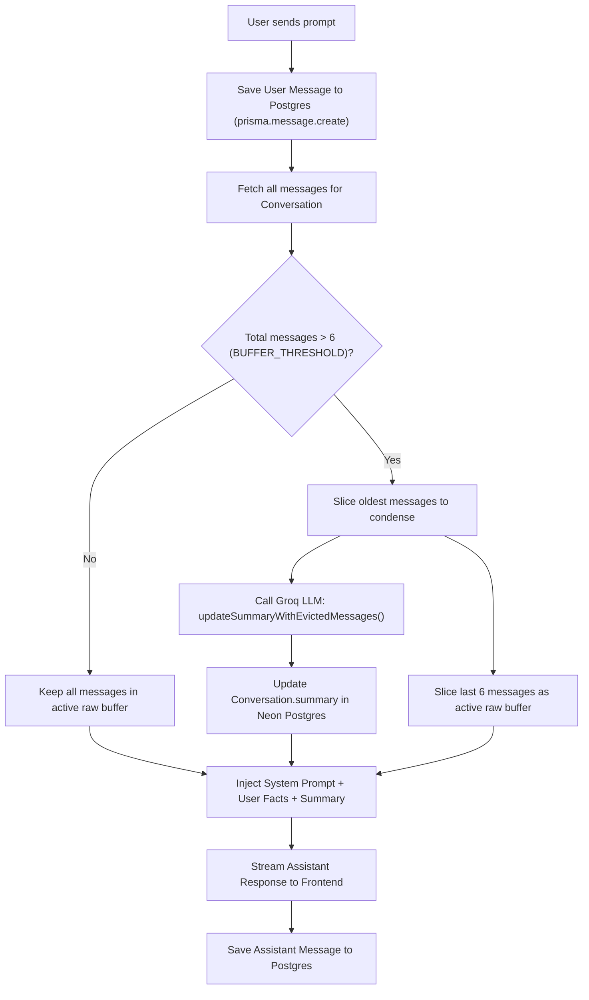

# Production-Ready AI Chatbot Architecture

Welcome to the development log and architecture guide for the **AI Chatbot** in CaseFy.ai. This document tracks our progression from a simple LLM prompt-response cycle to a full autonomous multi-tool agent with persistent memory.

---

## 🗺️ Progressive Learning Roadmap

| Status | Topic | Description |
| :---: | :--- | :--- |
| ✅ | **1. LLM Responses & Real-Time Streaming** | Base Prompt $\rightarrow$ Response, real-time SSE token streaming, ChatGPT-grade Markdown (tables, copyable code blocks), clean MVC controller & routes, custom Casefy AI identity. |
| ✅ | **2. Conversation Summary Buffer Memory** | Hybrid ChatGPT-style memory: active sliding window (6 recent messages) + automatic LLM compression of older dialogue into a running summary injected into system prompt. |
| ✅ | **3. PostgreSQL Session Persistence & History** | Storing conversations and messages in Neon PostgreSQL via Prisma. Full CRUD (list, fetch, rename, delete) and clean dynamic routes (`/chatbot/[id]`). |
| ✅ | **4. In-Memory Client Caching & UX State** | React `AppContext` caching for zero-network tab switching, skeleton loaders, and collapsible sidebar state persistence via `localStorage`. |
| ⏳ | **5. Context Window Boundaries & Token Exceed Limits** | Token calculations for `openai/gpt-oss-120b`, overflow detection, automatic message truncation, and compaction. |
| ⏳ | **6. Real-Time Tools & Function Calling** | Live Web Search tool, PPT presentation generator, Image generation, and autonomous tool-calling execution loops. |
| ⏳ | **7. Production Hardening** | Input guardrails, Zod schema validation, rate-limit retries, and fallback handling. |

---

## ⚡ Tech Stack & Architecture

- **LLM Provider:** [Groq Cloud](https://console.groq.com/) (Free Tier, ultra-fast inference).
- **Active Model:** `openai/gpt-oss-120b` (High-parameter open model running on Groq inference).
- **Database & ORM:** Neon PostgreSQL + Prisma ORM.
- **Backend Architecture (Clean MVC):**
  - **Prisma Client:** [`backend/src/lib/prisma.ts`](file:///Users/navneetkushwaha/Developers/CaseFy.ai/backend/src/lib/prisma.ts)
  - **AI Utilities:** [`backend/src/utils/ai.ts`](file:///Users/navneetkushwaha/Developers/CaseFy.ai/backend/src/utils/ai.ts) (Configures the OpenAI client instance and exports `CASEFY_SYSTEM_PROMPT`).
  - **Memory Utilities:** [`backend/src/utils/memory.ts`](file:///Users/navneetkushwaha/Developers/CaseFy.ai/backend/src/utils/memory.ts) (Title generator, sliding window condensation, and system prompt augmentation).
  - **Controller:** [`backend/src/controllers/chat.controller.ts`](file:///Users/navneetkushwaha/Developers/CaseFy.ai/backend/src/controllers/chat.controller.ts) (Handles streaming loop, conversation CRUD, validation, and completions).
  - **Router:** [`backend/src/routes/chat.routes.ts`](file:///Users/navneetkushwaha/Developers/CaseFy.ai/backend/src/routes/chat.routes.ts) (Mounted at `/api/chat`, protected with `isAuthenticated`).
- **Frontend Stack:**
  - Next.js (App Router), React, Tailwind CSS.
  - Route Architecture: Dynamic Route [`frontend/app/chatbot/[id]/page.tsx`](file:///Users/navneetkushwaha/Developers/CaseFy.ai/frontend/app/chatbot/[id]/page.tsx) and index [`frontend/app/chatbot/page.tsx`](file:///Users/navneetkushwaha/Developers/CaseFy.ai/frontend/app/chatbot/page.tsx).
  - Global In-Memory Cache: [`frontend/context/AppContext.tsx`](file:///Users/navneetkushwaha/Developers/CaseFy.ai/frontend/context/AppContext.tsx) (prevents repeated fetches on tab switches).
  - Markdown Engine: `react-markdown` + `remark-gfm` with custom `CodeBlock` component (dark theme + one-click copy).
  - Navigation: Shadcn collapsible sidebar with persistent history dropdown and active conversation indicators.

---

## 🗄️ Database Schema ([`backend/prisma/schema.prisma`](file:///Users/navneetkushwaha/Developers/CaseFy.ai/backend/prisma/schema.prisma))

We persist all conversations and messages directly in **Neon PostgreSQL**, completely decoupled from Legal Cases:

```prisma
model Conversation {
  id        String    @id @default(uuid())
  title     String    @default("New Chat")
  summary   String?   @db.Text
  userId    String
  user      User      @relation(fields: [userId], references: [id], onDelete: Cascade)
  messages  Message[]

  createdAt DateTime  @default(now())
  updatedAt DateTime  @updatedAt

  @@index([userId])
  @@index([updatedAt])
}

model Message {
  id             String       @id @default(uuid())
  role           String       // "user" | "assistant" | "system"
  content        String       @db.Text
  conversationId String
  conversation   Conversation @relation(fields: [conversationId], references: [id], onDelete: Cascade)

  createdAt      DateTime     @default(now())

  @@index([conversationId])
}
```

> **Key Architectural Decision:**  
> The `summary` column on `Conversation` stores the running compressed summary for that exact session. As dialogue exceeds the buffer, older messages are summarized and stored here, surviving server restarts and multiple user sessions.

---

## 🧠 PostgreSQL-Backed Summary Buffer Memory

### The Three-Tier Memory Architecture

```text
┌────────────────────────────────────────────────────────────────────────┐
│ 1. PERMANENT USER FACTS (Zero-Loss Store)                              │
│    - Extracted personal entities: e.g. "User's Name: Navneet"          │
│    - Always included in system prompt, never dropped by summarizer     │
├────────────────────────────────────────────────────────────────────────┤
│ 2. ROLLING CONVERSATION SUMMARY (Persisted in Postgres DB)             │
│    - Stored in `Conversation.summary` (@db.Text)                       │
│    - Background LLM compaction of evicted turns older than buffer      │
│    - Structured: USER FACTS + TOPICS DISCUSSED                         │
├────────────────────────────────────────────────────────────────────────┤
│ 3. ACTIVE SLIDING WINDOW BUFFER (Last 6 Raw Messages from Postgres)   │
│    - Last 6 messages verbatim from the `Message` table                │
│    - Retains exact code blocks, syntax, and immediate turn context     │
└────────────────────────────────────────────────────────────────────────┘
```

---

### How Summarization Works in Our Codebase

Every turn in [`chatHandler`](file:///Users/navneetkushwaha/Developers/CaseFy.ai/backend/src/controllers/chat.controller.ts) follows this exact memory lifecycle:



#### 1. Eviction and Condensation Logic ([`backend/src/controllers/chat.controller.ts`](file:///Users/navneetkushwaha/Developers/CaseFy.ai/backend/src/controllers/chat.controller.ts#L85-L115))

```typescript
const BUFFER_THRESHOLD = 6;
const allHistory = [...conversation.messages, userMessage];
let currentSummary = conversation.summary;
let recentMessages;

if (allHistory.length > BUFFER_THRESHOLD) {
  // Evict older turns beyond the 6 most recent
  const messagesToCondense = allHistory.slice(0, allHistory.length - BUFFER_THRESHOLD);
  recentMessages = allHistory.slice(-BUFFER_THRESHOLD).map((m) => ({
    role: m.role as 'user' | 'assistant' | 'system',
    content: m.content,
  }));

  // Update rolling summary in background and persist to PostgreSQL
  try {
    currentSummary = await updateSummaryWithEvictedMessages(currentSummary, messagesToCondense);
    await prisma.conversation.update({
      where: { id: conversation.id },
      data: { summary: currentSummary },
    });
  } catch (sumErr) {
    console.error('Failed to update summary in background:', sumErr);
  }
} else {
  recentMessages = allHistory.map((m) => ({
    role: m.role as 'user' | 'assistant' | 'system',
    content: m.content,
  }));
}
```

#### 2. The Summarization Prompt Engine ([`backend/src/utils/memory.ts`](file:///Users/navneetkushwaha/Developers/CaseFy.ai/backend/src/utils/memory.ts#L43-L88))

When messages are evicted, Groq is called with a specialized condensation prompt at a low temperature (`0.2`):

```typescript
export async function updateSummaryWithEvictedMessages(
  existingSummary: string | null | undefined,
  messagesToEvict: Array<{ role: string; content: string }>
): Promise<string> {
  const evictionText = messagesToEvict
    .map((msg) => `${msg.role.toUpperCase()}: ${msg.content}`)
    .join('\n');

  const summarizerPrompt = `You are a memory condensation engine for an AI assistant.
Your task is to update the existing conversation summary by merging the newly evicted conversation turns.

Rules:
1. Retain all user personal facts, names, goals, and key details. NEVER drop the user's name if present.
2. Summarize key topics discussed in 2 to 3 concise sentences.
3. Structure your response clearly:
USER FACTS: (e.g., Name: [Name], Goals: [Goals], etc.)
TOPICS DISCUSSED: (Summary of dialogue)

EXISTING SUMMARY:
${existingSummary || 'None'}

NEW CONVERSATION TURNS:
${evictionText}

UPDATED SUMMARY:`;

  const response = await openai.chat.completions.create({
    model: 'openai/gpt-oss-120b',
    messages: [{ role: 'user', content: summarizerPrompt }],
    temperature: 0.2,
    max_tokens: 300,
    stream: false,
  });

  return response.choices[0]?.message?.content?.trim() || existingSummary || '';
}
```

#### 3. Augmented Prompt Construction ([`backend/src/utils/memory.ts`](file:///Users/navneetkushwaha/Developers/CaseFy.ai/backend/src/utils/memory.ts#L93-L116))

Before generating the assistant's reply, the system prompt dynamically injects:
1. The base Casefy persona (`CASEFY_SYSTEM_PROMPT`).
2. Permanent User Facts (e.g., Name extracted from text or authenticated profile).
3. The persisted `Conversation.summary`.

```typescript
export function getAugmentedSystemPrompt(
  baseSystemPrompt: string,
  summary?: string | null,
  userName?: string | null
): string {
  const sections: string[] = [baseSystemPrompt];

  if (userName) {
    sections.push(`[PERMANENT USER FACTS]\n- User's Name: ${userName}`);
  }

  if (summary && summary.trim()) {
    sections.push(`[PRIOR CONVERSATION SUMMARY]\n${summary.trim()}`);
  }

  return sections.join('\n\n');
}
```

---

## 🔌 API Endpoints ([`backend/src/routes/chat.routes.ts`](file:///Users/navneetkushwaha/Developers/CaseFy.ai/backend/src/routes/chat.routes.ts))

All endpoints require JWT session authentication (`withCredentials: true`):

| Method | Endpoint | Description |
| :--- | :--- | :--- |
| `POST` | `/api/chat` | Send a message. Handles dynamic title generation, memory condensation, DB storage, and real-time SSE streaming. |
| `GET` | `/api/chat/conversations` | List all conversations for the authenticated user, ordered by `updatedAt DESC`. |
| `GET` | `/api/chat/conversations/:id` | Fetch a single conversation along with its chronological messages. |
| `PATCH` | `/api/chat/conversations/:id` | Rename a conversation title. |
| `DELETE` | `/api/chat/conversations/:id` | Delete a conversation and cascade delete its messages. |

---

## 💻 Frontend UX & Caching Architecture

### 1. In-Memory Caching Across Sidebar Tabs
To prevent repeated database queries whenever a user clicks between sidebar tabs (e.g., Dashboard $\rightarrow$ AI Chatbot $\rightarrow$ Evidence), the conversation list is elevated to [`AppContext.tsx`](file:///Users/navneetkushwaha/Developers/CaseFy.ai/frontend/context/AppContext.tsx):
- **First Load:** Fetched once from `/api/chat/conversations` and stored in React state.
- **Tab Switching:** Read directly from memory with **0 network requests** and **0 latency**.
- **Sync on Updates:** Sending a message or deleting a conversation dispatches a `chat-updated` event that refreshes the cached list in the background.

### 2. URL Dynamic Routing
- Navigation uses clean Next.js App Router paths: `http://localhost:3000/chatbot/[id]`.
- Direct URL loads (e.g., bookmarking or page refreshes) fetch the specific conversation from PostgreSQL and display skeleton loaders while hydrating.

### 3. Persistent Sidebar Dropdown State
- The open/closed state of the History section in the sidebar is saved in `AppContext` and backed by `localStorage` (`casefy_sidebar_history_open`).
- When closed, it stays closed when navigating between tabs and will never pop open automatically.

---

## 📊 Summary of What's Completed vs Next

### ✅ Completed:
1. **Streaming & Persona:** Groq `openai/gpt-oss-120b`, real-time SSE chunks, Markdown with code copy.
2. **PostgreSQL Persistence:** Neon PostgreSQL `Conversation` and `Message` models via Prisma.
3. **Database-Backed Summary Buffer Memory:** 6-message sliding window, automatic LLM condensation saved in `Conversation.summary`, and permanent user facts.
4. **Full UI Integration:** Dynamic routes (`/chatbot/[id]`), in-memory tab caching, message skeletons, and history sidebar.

### ⏳ Next Upcoming Topics:
1. **Context Window & Token Management:** Calculating token consumption and handling model token limits gracefully.
2. **Autonomous Tool Calling:**
   - 🔍 **Real-Time Web Search Tool**
   - 📊 **PowerPoint Presentation Generator Tool**
   - 🎨 **Image Generation Tool**
   - **ReAct Agentic Execution Loop**
3. **Production Hardening:** Zod validation, rate-limit retry mechanisms, and fallback providers.
